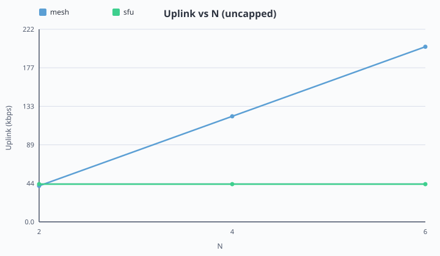
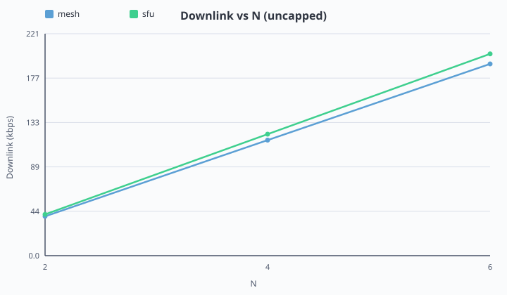
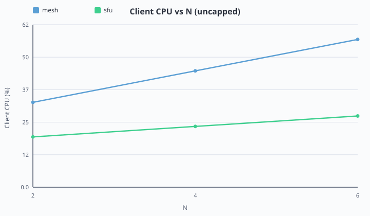
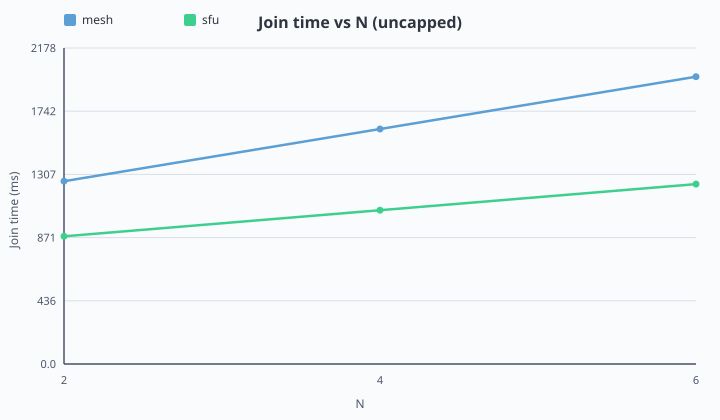
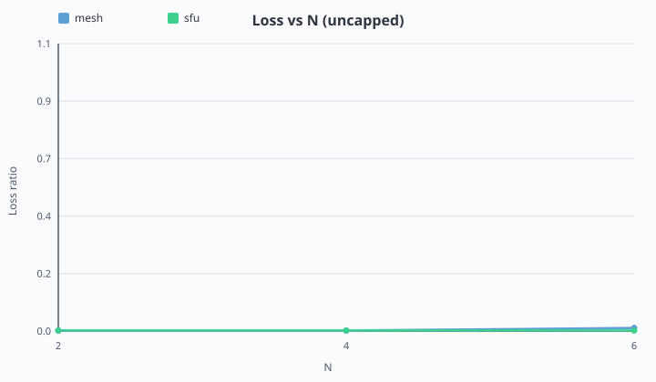

# Project 23: WebRTC Group Calling — Mesh vs SFU Architecture and Bandwidth Scaling

- **Author(s):** Faizan Basheer (24K0571), Pankaj Lal (24K0805)
- **Date:** 2026-10-23
- **Environment:** Lab / single-laptop; Node 18+; Chromium via Puppeteer; LiveKit `--dev`
- **Data note:** Generated from dashboard/client/public/fixtures/summary/bitrate-vs-n.csv

---

## 1. Abstract

This project implements group audio calling in **mesh** (N−1 peer connections) and **SFU** (LiveKit) modes, then measures scaling for N = 2…6 with Puppeteer automation. Uncapped summary data show mesh uplink rising with N while SFU uplink stays roughly flat (mesh uplink 41→201 kbps (N=2→6); sfu uplink 43→43 kbps (N=2→6)). Under uplink caps, failure detection (loss > 5% or mesh floor `(N−1)×25 kbps`) produces `failure-points.md` for report annotation.

---

## 2. Introduction

- **Problem:** 1:1 WebRTC does not scale; mesh uplink grows with N−1.
- **Goal:** relate architecture choice to throughput demands and access-link bottlenecks.
- **Modes:** Mesh (custom WebSocket signaling) vs SFU (LiveKit).

---

## 3. Background

- **Mesh:** N−1 `RTCPeerConnection`s; P2P UDP media; signaling over WebSocket.
- **SFU:** one publish uplink; selective forward without mixing.
- **Protocols:** ICE/STUN, DTLS-SRTP, RTP/RTCP, WebSocket signaling, UDP media.

---

## 4. Architecture and Implementation

### 4.1 Mesh

Node/Express + `ws` room registry; React/Vite client; perfect negotiation; automation hooks (`__webrtcReady`, `__waitUntilConnected`, `__webrtcStats`).

### 4.2 SFU

LiveKit `--dev`; Express token API; React publish/subscribe client; same automation hook contract.

### 4.3 Automation

Puppeteer + fake media; `runOnce` / `runMatrix`; `pidusage` CPU; schema-v1 JSON; `summarize` → CSV + failure points; optional `tc-uplink.sh` via `--tc-iface`.

---

## 5. Experimental Method

- **Matrix:** N = 2…6; modes mesh/sfu; caps `uncapped` / `1Mbps` / `5Mbps` on capped peer (`p1`).
- **Duration / interval:** typically 60–90 s, sample every 2 s; means drop first ~10 s ramp.
- **Failure criteria:** mean loss > 5%, or mesh capped-peer median uplink < `(N−1)×25 kbps`; CPU ≥ 90% → CPU-bound inconclusive.
- **tc:** Linux `scripts/tc-uplink.sh apply <iface> 1mbit|5mbit` when `--tc-iface` is set.

---

## 6. Results

### 6.1 Uncapped scaling









| mode | n | uplink kbps | downlink kbps | CPU client | join ms | loss |
| --- | --- | --- | --- | --- | --- | --- |
| mesh | 2 | 41.44 | 39.20 | 32.40 | 1260 | 0.0020 |
| mesh | 4 | 121.44 | 115.20 | 44.40 | 1620 | 0.0020 |
| mesh | 6 | 201.44 | 191.20 | 56.40 | 1980 | 0.0120 |
| sfu | 2 | 43.44 | 41.20 | 19.20 | 880 | 0.0020 |
| sfu | 4 | 43.44 | 121.20 | 23.20 | 1060 | 0.0020 |
| sfu | 6 | 43.44 | 201.20 | 27.20 | 1240 | 0.0020 |


### 6.2 Uplink-limited scaling

_No 1Mbps rows in current summary CSV — run capped matrix on Linux with `--tc-iface`._


_No 5Mbps rows in current summary CSV._




### 6.3 Failure point

| Cap | Mesh fails at N | SFU status at that N |
|-----|-----------------|----------------------|
| 1 Mbps | — (no-data) | — |
| 5 Mbps | — (no-data) | — |

_Run `npm run summarize` after capped experiments to populate failure-points.md._


---

## 7. Discussion

- Uncapped mesh uplink scales upward with N; SFU uplink remains near one stream — matching the O(N−1) vs ~O(1) model.
- Under caps, access-link shaping (when `tc` is applied) is expected to fail mesh earlier than SFU; if only CPU ≥ 90% is observed, classify as CPU-bound / inconclusive on a single laptop.
- **Limitations:** single-laptop CPU confound, fake media, audio-first, lab LAN; NIC `tc` on one host shapes all local browsers.

---

## 8. Conclusion

Architecture choice maps directly to uplink demand: mesh multiplies sends by N−1 while an SFU keeps client uplink roughly constant, shifting cost to the middlebox and downlink. Measured summary curves and failure-point rules make that bottleneck relationship concrete for the lab report.

---

## 9. Optional Advanced Work

Not started in Phase 8 core polish (simulcast / active speaker / TURN remain optional per IMPLEMENTATION_PLAN).

---

## Appendix A — How to Run

```bash
npm install
cp .env.example .env

# Mesh
npm run mesh
npm run mesh:client

# SFU
npm run livekit
npm run sfu
npm run sfu:client

# One run / matrix / summarize / plot / report
npm run run-once -- --mode mesh --n 2 --duration 20 --cap uncapped
npm run matrix -- --dry-run
npm run summarize
npm run plot
npm run fill-report

# Linux uplink cap
sudo ./scripts/tc-uplink.sh apply eth0 1mbit
npm run run-once -- --mode mesh --n 3 --cap 1Mbps --tc-iface eth0 --duration 20
sudo ./scripts/tc-uplink.sh clear eth0
```

## Appendix B — Raw Data Index

- Schema: `schemaVersion: 1` ([DATA_SCHEMA.md](DATA_SCHEMA.md))
- Runs: `results/{mesh,sfu}/n{N}-{cap}-{trial}.json`
- Summary: `results/summary/bitrate-vs-n.csv`
- Failure points: `results/summary/failure-points.md`
- Fixtures (pre-live): `dashboard/client/public/fixtures/`

## Appendix C — Packet Captures

Optional: Wireshark filter `udp or websocket` — TCP signaling vs UDP media.
